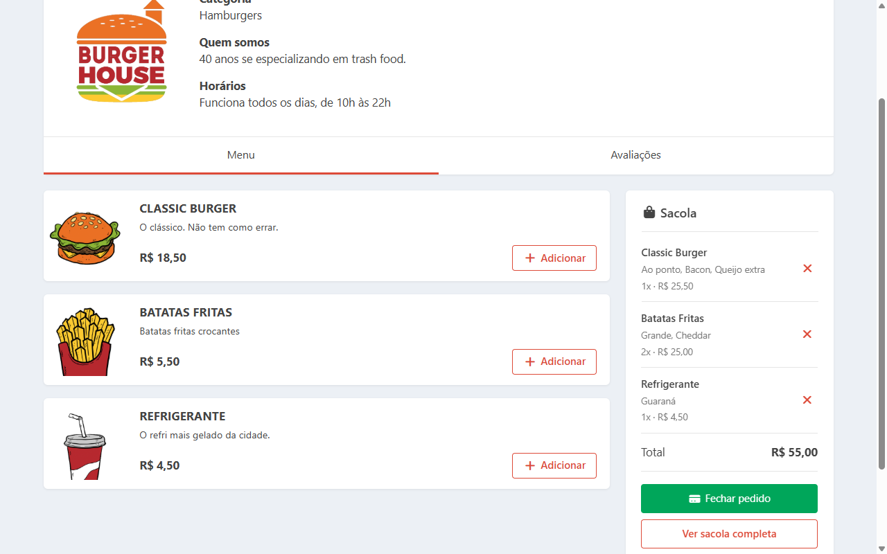
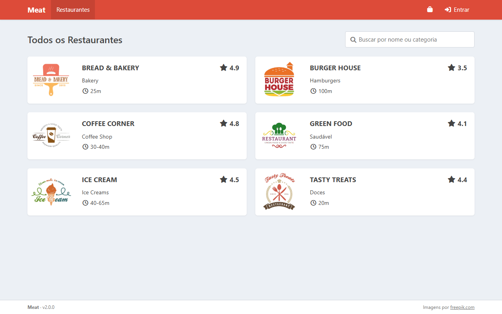
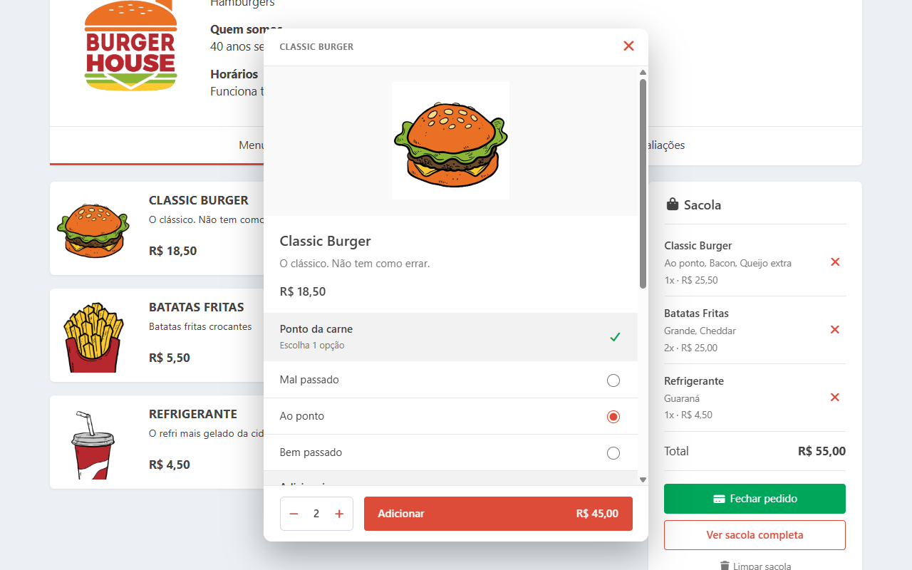
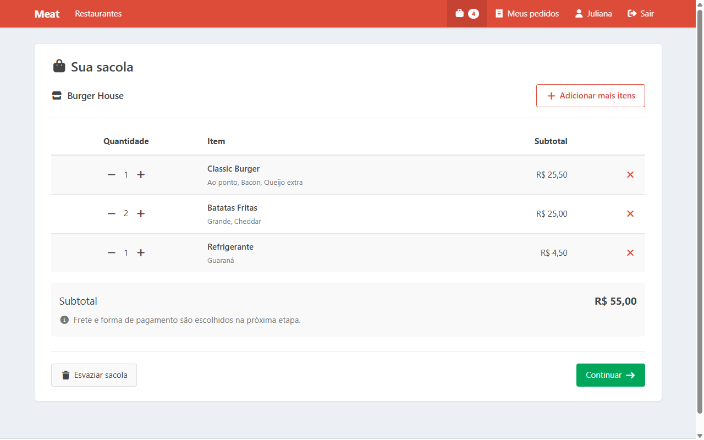
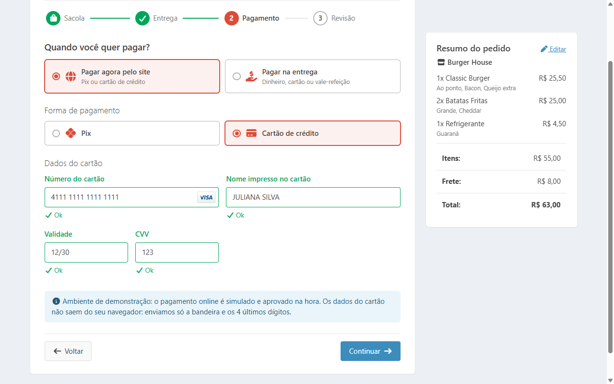
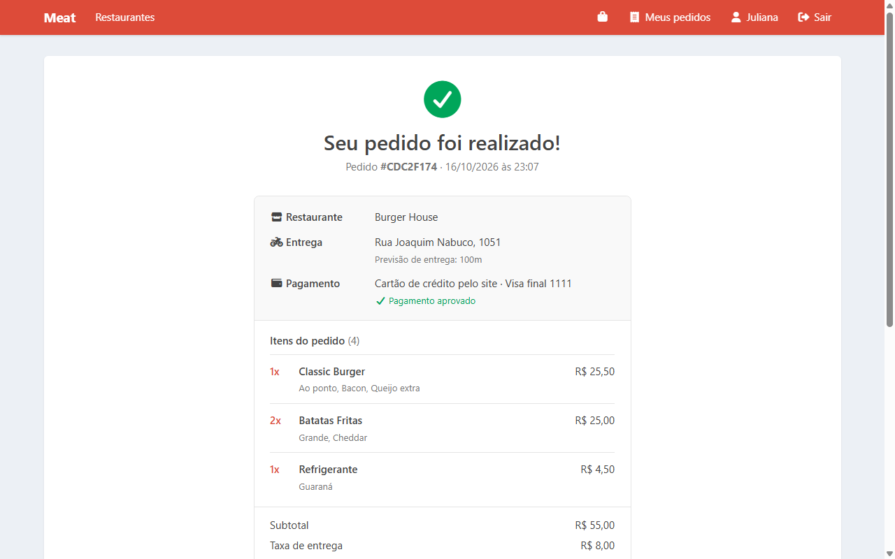
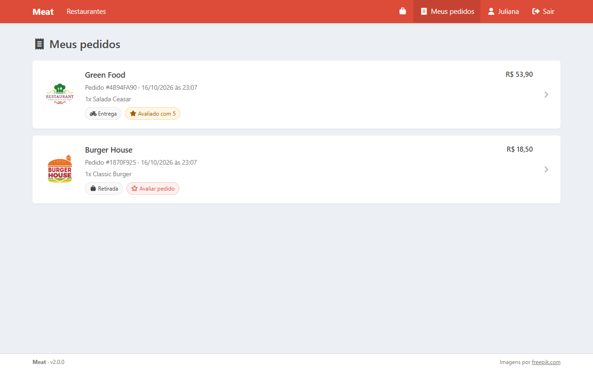
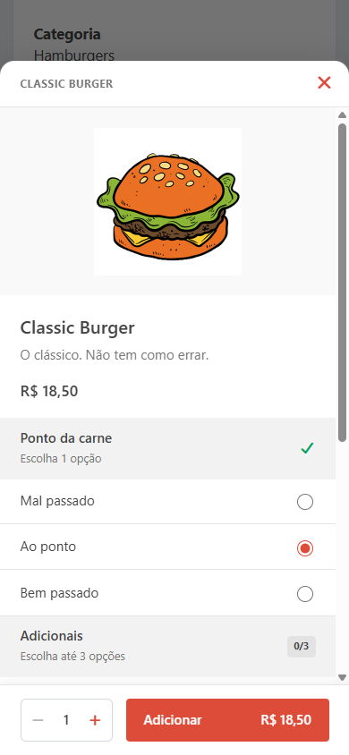

# Meat — app de delivery em Angular 22

[](https://github.com/CristianAndrade23/MeatApp/actions/workflows/ci.yml)


Aplicação de pedidos de comida, inspirada no iFood: restaurantes e cardápio, itens com opções e adicionais, sacola, checkout em etapas (entrega ou retirada, pagamento online ou na entrega), conta de usuário, histórico de pedidos e avaliações.

Frontend em **Angular 22** (componentes standalone, signals, Signal Forms, zoneless) e API em **Express 5 + JWT**, cobertos por testes unitários, de API e **E2E com Cypress**.

**[Abrir a demo](https://cristianandrade23.github.io/MeatApp/)** · entre com `juliana@gmail.com` / `juliana23` ou crie uma conta

A demo roda no GitHub Pages com a API dentro do navegador, usando as **mesmas regras de negócio** do backend Express. Abre na hora, sem servidor para "acordar", e os pedidos ficam salvos no seu navegador.



## Sumário

- [Funcionalidades](#funcionalidades)
- [Telas](#telas)
- [Tecnologias](#tecnologias)
- [Como rodar](#como-rodar)
- [Testes](#testes)
- [Destaques técnicos](#destaques-técnicos)
- [Estrutura do projeto](#estrutura-do-projeto)
- [API](#api)
- [História do projeto](#história-do-projeto)
- [Licença e créditos](#licença-e-créditos)

## Funcionalidades

**Restaurantes e cardápio**
- Lista de restaurantes com busca por nome ou categoria
- Detalhe do restaurante com cardápio e avaliações
- Modal do item no estilo iFood: grupos de opções obrigatórios ou opcionais (ponto da carne, tamanho, adicionais pagos com limite), observação, quantidade e total

**Sacola**
- Página própria, acessível pelo header, sem exigir login
- Itens de um restaurante por vez, como em apps de delivery; ao trocar, o app pede confirmação
- Salva no navegador: continua lá depois de recarregar a página

**Checkout em etapas** (Sacola → Entrega → Pagamento → Revisão)
- Entrega no endereço ou retirada na loja (sem frete, com endereço e horário do restaurante)
- Pagar agora pelo site (Pix ou cartão de crédito) ou na entrega/retirada (dinheiro com troco, débito, crédito, vale-refeição)
- Validação do cartão no navegador (algoritmo de Luhn, bandeira, validade)
- Dá para voltar à sacola, mudar itens e retomar da mesma etapa sem perder as escolhas

**Conta e pedidos**
- Cadastro e login com JWT; ao entrar, a pessoa volta para onde estava
- Comprovante do pedido com número, itens, entrega, pagamento e valores
- **Meus pedidos**: histórico e detalhe de cada pedido
- Avaliação do pedido (nota e comentário), publicada nas avaliações do restaurante

> O pagamento online é **simulado**: nenhum valor é cobrado e os dados do cartão não saem do navegador. O servidor recebe só a bandeira e os 4 últimos dígitos.

## Telas

| | |
|---|---|
|  |  |
| **Restaurantes** com busca | **Modal do item** com opções e adicionais |
|  |  |
| **Sacola** com opções escolhidas | **Checkout**: etapa de pagamento |
|  |  |
| **Pedido realizado** (comprovante) | **Meus pedidos** com status da avaliação |

<p align="center">
  <br>
  <b>No celular</b>, o modal do item abre como gaveta, como no app do iFood
</p>

## Tecnologias

| Camada | Tecnologias |
|---|---|
| Frontend | Angular 22 (standalone, signals, Signal Forms, `httpResource`, zoneless), TypeScript, CSS próprio, Font Awesome |
| Backend | Node.js, Express 5, JWT (`jsonwebtoken`), senhas com `scrypt`, banco em arquivo JSON |
| Testes | Vitest (unitários), `node:test` (API), Cypress (E2E) |
| CI/CD | GitHub Actions: build e as três camadas de testes a cada push e PR; deploy da demo no GitHub Pages |

## Como rodar

**Pré-requisitos:** [Node.js](https://nodejs.org) 22.22+, 24.15+ ou 26+ e Git.

```bash
git clone https://github.com/CristianAndrade23/MeatApp.git
cd MeatApp
npm install          # instala frontend e backend
```

**Modo desenvolvimento** (com recarga automática), em dois terminais:

```bash
npm run api          # terminal 1: API em http://localhost:3000/api
npm start            # terminal 2: app em http://localhost:4200
```

**Ou tudo com um comando só** (build de produção servido pela própria API):

```bash
npm run serve:prod   # app e API em http://localhost:3000
```

**Sem backend** (a API roda no navegador, como na demo publicada):

```bash
npm run start:demo   # app em http://localhost:4200
```

**Usuários de teste** (ou crie uma conta em *Criar conta*):

| Email | Senha |
|---|---|
| `juliana@gmail.com` | `juliana23` |
| `amanda@gmail.com` | `amanda21` |

Os pedidos, contas criadas e avaliações ficam em `backend/data/db.json`, que é criado no primeiro uso e fica fora do git. Para recomeçar do zero, basta apagar esse arquivo.

## Testes

```bash
npm test             # unitários do frontend (Vitest)
npm run test:api     # API (node:test)
npm run e2e          # ponta a ponta com Cypress, sem interface
npm run e2e:open     # Cypress interativo
```

| Camada | Quantidade | O que cobre |
|---|---|---|
| Unitários (Vitest) | 61 | Sacola, regras do checkout, cartão, formulários, interceptors, componentes e a API do modo demo |
| API (`node:test`) | 44 | Endpoints, validações, cálculo de preços, autenticação e isolamento entre usuários |
| E2E (Cypress) | 21 | Navegação, modal do item, sacola, checkout completo, cadastro, Meus pedidos e avaliação |

`npm run e2e` não precisa da API rodando. Ele gera o build, sobe um servidor próprio na porta 4300 com banco temporário (restaurado antes de cada teste), roda o Cypress e desliga tudo no final.

<details>
<summary>Detalhes dos testes E2E</summary>

- Specs em `cypress/e2e/`. Comandos customizados em `cypress/support/commands.ts`: `cy.visitAs()` (entra logado pela API), `cy.addToBag()`, `cy.createOrder()`, `cy.choose()` e `cy.resetDb()`.
- `npm run docs:screenshots` regenera as imagens deste README com o próprio Cypress (`cypress/docs/screenshots.cy.ts`).
- Os scripts iniciam o Cypress por `cypress/run-cypress.mjs`, que remove a variável `ELECTRON_RUN_AS_NODE` definida pelo terminal do VS Code. Sem isso, o Cypress falha com `bad option: --smoke-test`.

</details>

## Destaques técnicos

- **Estado com signals:** a sacola é um store de signals (`computed` para total e contagem, `effect` para salvar no `localStorage`); o rascunho do checkout fica num serviço para sobreviver à navegação.
- **Signal Forms com regras condicionais:** o endereço só é obrigatório na entrega (`applyWhen`), os dados do cartão só no pagamento online com crédito, e o troco é validado contra o total do pedido.
- **`httpResource`** para dados de leitura (restaurantes, cardápio, pedidos), com busca com debounce via `toObservable`/`toSignal`.
- **O servidor não confia no cliente:** frete, preço dos adicionais e total são recalculados no backend a partir do cardápio. O pedido guarda uma cópia dos nomes e preços do momento da compra.
- **Uma regra de negócio, dois ambientes:** validações e cálculos da API ficam em [`src/app/core/backend/rules.ts`](src/app/core/backend/rules.ts), TypeScript puro usado pelo Express e pela API do modo demo (um `HttpInterceptorFn` carregado sob demanda, que nem entra no build normal). Por isso a demo e o servidor não divergem.
- **Segurança:** senhas com `scrypt` e comparação em tempo constante; JWT com expiração; pedido de outro usuário responde 404, sem revelar que existe; `?to=` do login aceita só caminhos internos.
- **Acessibilidade:** `<dialog>` nativo para modais (foco preso, Esc fecha), foco inicial na ação segura nas confirmações, labels e `aria-*` nos controles.
- **Sem dependências desnecessárias:** CSS próprio no lugar de Bootstrap/jQuery, e o backend roda TypeScript direto no Node, sem etapa de build.

## Estrutura do projeto

```
src/app/
  core/               modelos, autenticação, interceptors HTTP, notificações, confirmação
    backend/          regras de negócio da API (compartilhadas com o Express)
    demo/             API do modo demo, que roda no navegador (GitHub Pages)
  layout/             header, snackbar e modal de confirmação
  pages/              home e 404
  restaurants/        lista de restaurantes
  restaurant-detail/  detalhe, cardápio, modal do item e avaliações
  cart/               store da sacola (signals), página da sacola e sacola lateral
  order/              checkout em etapas, comprovante, Meus pedidos e avaliação
  security/           login e cadastro
  shared/             dialog, input com validação, radio e rating
backend/
  src/                servidor Express (HTTP, JWT e banco em arquivo JSON)
  data/seed.json      catálogo: restaurantes, cardápio, avaliações e usuários de teste
  test/               testes da API
cypress/
  e2e/                testes E2E
  e2e-server.mts      servidor dos testes (porta 4300, banco temporário)
docs/screenshots/     imagens deste README
```

## API

Base: `/api`. Rotas marcadas com 🔒 exigem `Authorization: Bearer <token>`.

| Método | Rota | Descrição |
|---|---|---|
| `GET` | `/restaurants?q=` | Lista restaurantes, com busca opcional |
| `GET` | `/restaurants/:id` | Detalhe do restaurante |
| `GET` | `/restaurants/:id/menu` | Cardápio, com os grupos de opções de cada item |
| `GET` | `/restaurants/:id/reviews` | Avaliações, mais recentes primeiro |
| `POST` | `/login` | Login; devolve nome, email e token |
| `POST` | `/users` | Cadastro; devolve a sessão |
| `POST` | `/orders` 🔒 | Cria o pedido (valida itens, opções, entrega e pagamento; calcula os valores) |
| `GET` | `/orders` 🔒 | Pedidos do usuário logado |
| `GET` | `/orders/:id` 🔒 | Detalhe do pedido |
| `POST` | `/orders/:id/review` 🔒 | Avalia o pedido (uma vez por pedido) |

Em produção, defina a variável `JWT_SECRET` (obrigatória com `NODE_ENV=production`). Também são aceitas `PORT` e `DB_FILE`. Para cadastrar outro usuário de teste no seed, gere o hash com `npm --prefix backend run hash-password -- <senha>`.

## História do projeto

A primeira versão do Meat foi feita em 2019, em Angular 4 com AdminLTE e `json-server`. Em 2026 o app foi reescrito do zero com Angular 22 e ganhou backend próprio, login, checkout completo e testes.

| | Versão 1 (2019) | Versão 2 (2026) |
|---|---|---|
| Frontend | Angular 4, NgModules, RxJS 5 | Angular 22, standalone, signals, Signal Forms, zoneless |
| Estilo | AdminLTE 2 + Bootstrap 3 + jQuery | CSS próprio |
| Backend | `json-server` | Express 5 + JWT |
| Testes | Karma + Jasmine + Protractor (gerados, sem uso) | Vitest, `node:test` e Cypress, rodando no CI |

A reescrita está documentada nos [pull requests](https://github.com/CristianAndrade23/MeatApp/pulls?q=is%3Apr+is%3Amerged).

## Licença e créditos

[MIT](LICENSE). © 2019–2026 Cristian Andrade.
Imagens de restaurantes e comidas por [freepik.com](https://www.freepik.com).
